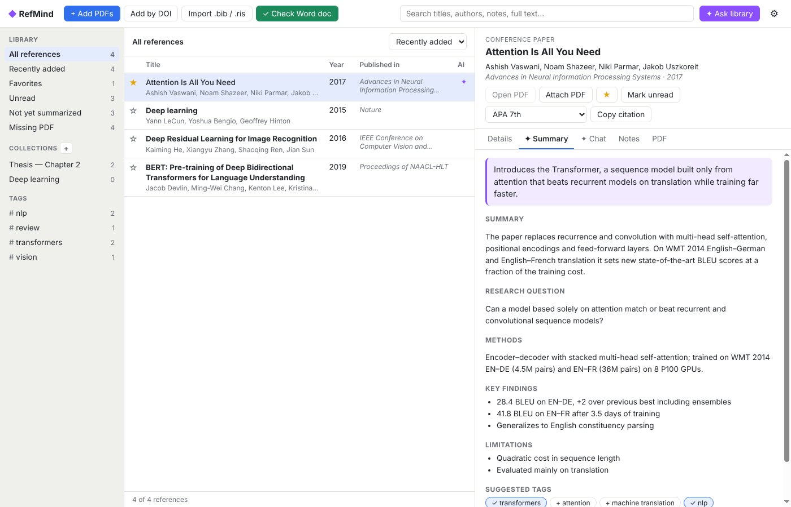
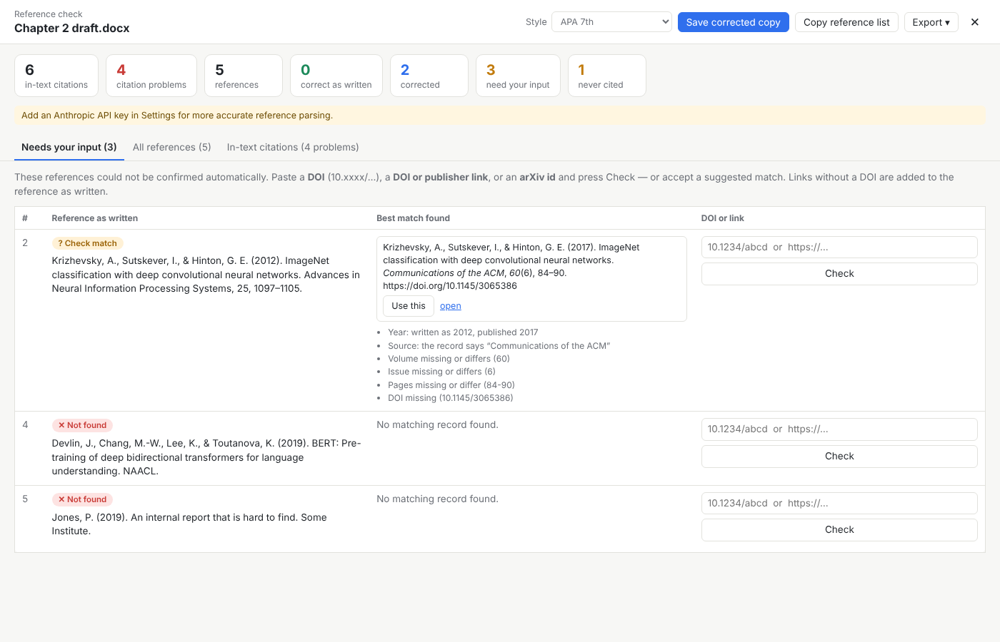
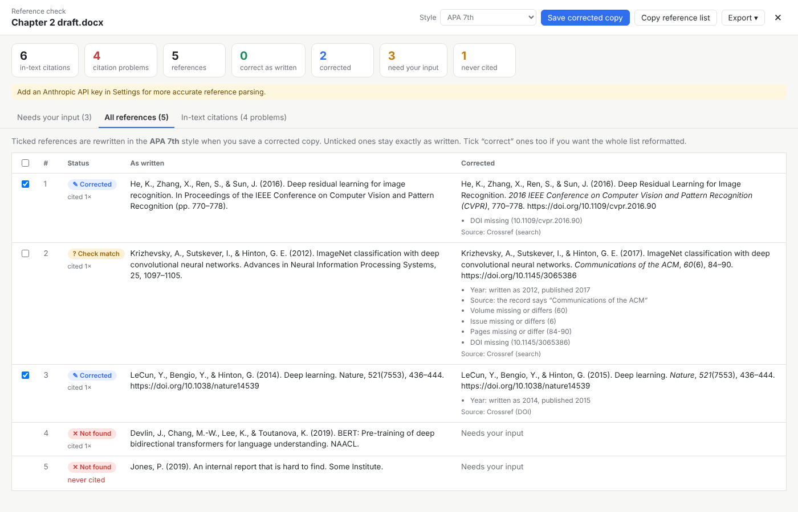
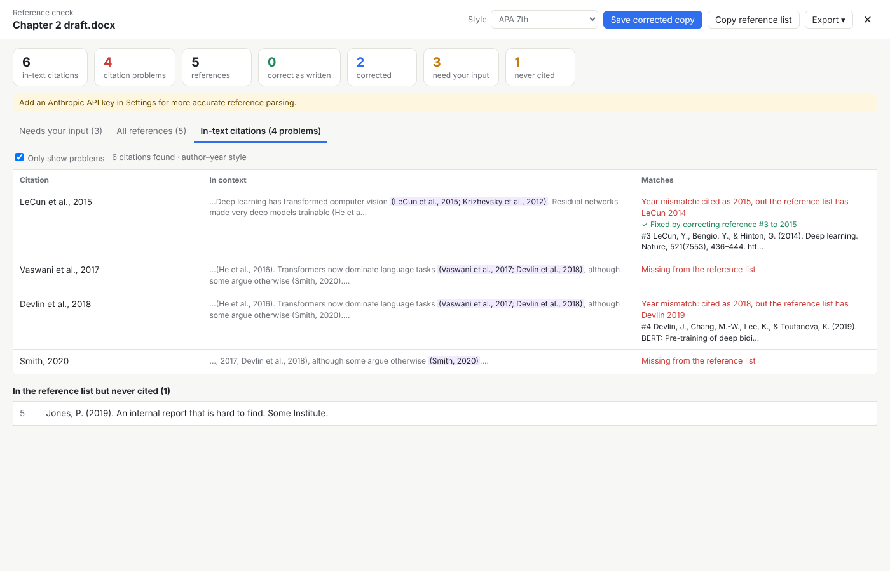

# RefMind — AI reference manager

A desktop reference manager in the spirit of Mendeley, with Claude built in. It runs on Windows, macOS and Linux.



- **Add papers by dropping PDFs.** RefMind reads each PDF and finds its DOI or arXiv id, then fills in title, authors, journal, year, volume and pages from Crossref or arXiv. When a PDF has no identifier, Claude extracts the metadata from the first pages.
- **Organize.** Collections and sub-collections, tags, favorites, read/unread, and notes. Search covers titles, authors, abstracts, notes and the full text of every PDF.
- **AI summaries.** Get a TL;DR, summary, research question, methods, key findings and limitations for each paper, plus suggested topic tags.
- **Chat with a paper.** Ask questions about one paper. Claude reads the whole PDF, including its figures and tables.
- **Ask your library.** Ask questions across all your papers, a collection, or a selection. Answers cite your papers as clickable `[n]` links.
- **Check a Word manuscript** (see below).
- **Cite and export.** Copy a formatted citation in APA, MLA, Chicago, Harvard, IEEE or Vancouver. Export BibTeX, RIS or a formatted bibliography.
- **Coming from Mendeley or Zotero?** Export your library as BibTeX or RIS and import it. PDF paths in Mendeley `.bib` exports are attached automatically.

## Checking references in a Word document

Click **✓ Check Word doc**, or drop a `.docx` onto the window. RefMind:

1. Finds every **in-text citation**: author–year (`(Smith & Jones, 2020a)`, `Smith et al. (2019)`) and numeric (`[3]`, `[4–7]`), in the body and in footnotes.
2. Finds the **reference list** after its heading (References, Bibliography, Works Cited, and others) and parses each entry. Claude does the parsing when you have an API key; otherwise RefMind uses heuristics.
3. **Cross-checks** citations against the list. It reports citations missing from the list, year mismatches (cited 2018, listed 2019), likely misspellings, ambiguous citations that need a/b suffixes, and references that are never cited.
4. **Verifies each reference** against Crossref and arXiv. It uses the DOI when the entry has one and searches otherwise, then reports what differs from the published record: year, authors, title, journal, volume, issue, pages, or a missing or wrong DOI. If the document was written with Mendeley or Zotero, it also uses the citation data they embed in the file.
5. Puts references it **can't confirm** in a table where you paste a DOI, a DOI or publisher link, or an arXiv id. It reads the DOI from publisher pages. A link with no DOI (a report or web page) is added to the reference as written.
6. **Saves a corrected copy** of the document with the references you accept rewritten in your chosen style, keeping paragraph formatting. Your original file is never modified. You can also copy the corrected list, export it as `.bib` or `.ris`, save a CSV report, or add the references to your library.





Corrections are only applied automatically when the match is certain. A different version of the same work, such as a later journal reprint of a conference paper, is shown as "Check match" for you to decide.

## Running it

Requires [Node.js](https://nodejs.org) 20 or newer.

```bash
npm install
npm start
```

Then open **Settings (⚙)** and paste an [Anthropic API key](https://console.anthropic.com/) to turn on the AI features. Without a key, everything except summaries, chat and AI parsing still works. The key is encrypted with your operating system's keychain. You can also set it with the `ANTHROPIC_API_KEY` environment variable.

The default model is Claude Opus 5.5. You can switch to Sonnet 5.5 (faster, cheaper) or Haiku 5.5 (cheapest) in Settings.

### Building an installer

```bash
npm run dist        # builds for the current OS into dist/
```

## Privacy

Your library lives in a local folder: Settings → Library folder. It holds `library.json`, the PDFs, and their extracted text. Data only leaves your computer in these cases:

- **Crossref and arXiv** receive DOIs and reference text for metadata lookups. You can turn this off in Settings.
- **Anthropic** receives a paper only when you use an AI feature on it: summary, chat, metadata extraction, or reference parsing.

## Development

```bash
npm test            # unit tests (no network or API key needed)
```

| Path | What it does |
| --- | --- |
| `src/main/main.js` | Electron main process: window and IPC |
| `src/main/store.js` | Library storage and search |
| `src/main/importer.js` | PDF import pipeline |
| `src/main/pdf.js` | PDF text extraction (pdf.js) |
| `src/main/lookup.js`, `identifiers.js` | Crossref and arXiv lookups, DOI detection |
| `src/main/ai.js` | Claude: metadata, summaries, chat, library Q&A, reference parsing |
| `src/main/docx.js` | Reading and patching `.docx` files |
| `src/main/checker.js` | Manuscript reference checker |
| `src/shared/citations.js` | Citation styles, BibTeX and RIS import/export |
| `src/shared/intext.js` | In-text citation and reference-list detection, cross-checking |
| `src/renderer/` | User interface |

`.npmrc` sets `omit=optional` because pdf.js otherwise installs `@napi-rs/canvas`, a native module that crashes inside Electron. Text extraction doesn't need it.

`test/e2e/screens.js` drives the real app through its main screens and saves screenshots, using simulated lookups:

```bash
npx electron test/e2e/screens.js ./screenshots
```
